<p align="center">
  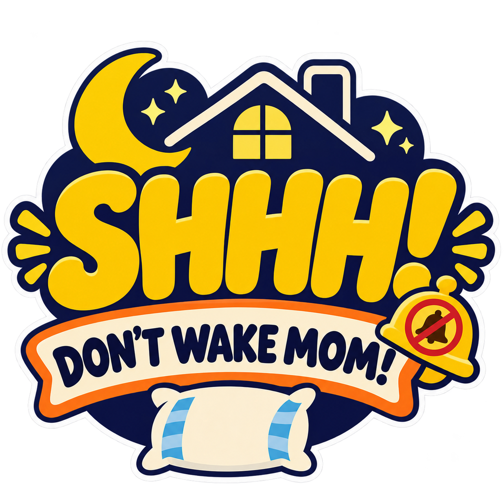
</p>

<h1 align="center">SHHH! — Don't Wake Mom!</h1>

<p align="center">
  <b>A hand-tracked VR comedy for Meta Quest about doing chores… very, very quietly.</b><br/>
  Four siblings. One sleeping Mom. A whole house of chores — and every clink, crash and bang wakes her up a little more.
</p>

<p align="center">
  <a href="https://youtu.be/-rLk_TchwqM">▶ Gameplay Demo</a> ·
  <a href="https://youtu.be/ASPxLhoNgGo">▶ Trailer</a> ·
  <a href="https://youtu.be/ZPQLpE68QZY">▶ Full Walkthrough</a> ·
  <a href="https://www.meta.com/s/5gSiHWyOg">🥽 Get it on Meta Quest (test channel)</a>
</p>

<p align="center">
  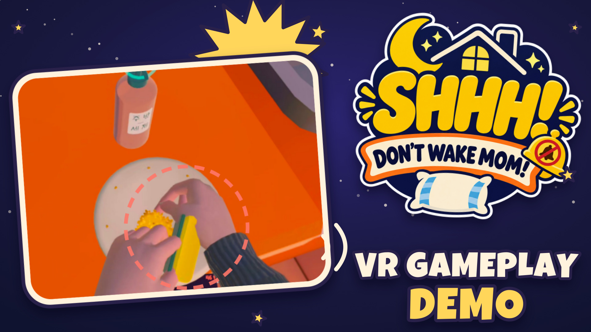
</p>

---

## Table of contents
1. [Videos](#-videos)
2. [Play it on Meta Quest](#-play-it-on-meta-quest)
3. [The game](#-the-game)
4. [Screenshots](#-screenshots)
5. [Features (what you can see working in the videos)](#-features)
6. [How to play](#-how-to-play)
7. [Tech stack](#-tech-stack)
8. [Architecture](#-architecture)
9. [Repository layout](#-repository-layout)
10. [Building the game](#-building-the-game)
11. [Testing & QA](#-testing--qa)
12. [Video production pipeline (trailer, walkthrough, competition demo)](#-video-production-pipeline)
13. [What is NOT in this repository (and why)](#-what-is-not-in-this-repository)
14. [Credits & licences](#-credits--licences)

---

## 🎬 Videos

| Official VR Gameplay Demo — Meta VR Start 2026 | Official Game Trailer | Official Gameplay Walkthrough |
|---|---|---|
| [](https://youtu.be/-rLk_TchwqM) | [](https://youtu.be/ASPxLhoNgGo) | [](https://youtu.be/ZPQLpE68QZY) |
| 2:53 · real hands-on chores, sabotage, Mom's interrogation, online play | 1:43 · the cinematic story of one very loud night | ~19 min · menus, practice, one full uncut 10-minute match, an online room |
| https://youtu.be/-rLk_TchwqM | https://youtu.be/ASPxLhoNgGo | https://youtu.be/ZPQLpE68QZY |

Every gameplay shot in all three videos is **real footage recorded on a Meta Quest headset** from in-development builds — nothing staged,
no fake features. How they were made is documented in [`VideoProduction/`](VideoProduction/) (see [the pipeline section](#-video-production-pipeline)).

## 🥽 Play it on Meta Quest

**Meta Horizon store link (release-channel invite):** https://www.meta.com/s/5gSiHWyOg

- The link opens app **1474568005729516** ("SHHHH! Don't Wake Mom") on a private **release channel** (an invite link, not a public store page);
  sign in with your Meta account to join and install it on Quest 2 / Quest Pro / Quest 3 / Quest 3S.
- Package: `com.shhhgame.dontwakemom`. Latest build in this repo's history: **0.6.14 (versionCode 23, "c23")** — see
  [`Builds/Quest2_3_3S/BUILDS.csv`](Builds/Quest2_3_3S/BUILDS.csv). Which build the channel currently serves is set in the Meta developer
  dashboard (Distribution → Release channels).

## 🏠 The game

It's late. The house is a disaster. And Mom is **finally asleep**.

You and your siblings (other players online, or bots) have one continuous **5- or 10-minute** night to do your jobs all over a fully connected
house — kitchen, living room, laundry — with your **real hands**: scrub plates, pump soap, open the fridge by its handle, sort the toy
blocks, fold blankets and towels, pair the slippers, feed the pets… **quietly**.

Every noise you make fills **Mom's sleep meter**. Clink a plate, drop a book, let the dog bark — Mom stirs, mutters, then gets up and comes to
look. When she finds a mess she wants a name: on her **interrogation board** you can point at a sibling, show what you saw (the cat did it!)
or say nothing. Get caught and you lose points and sit out a short timeout. And yes — you can **sneakily mess up a rival's job**… but
someone may be watching.

When the clock hits zero, Mom inspects the house and **the most helpful kid wins**.

## 📸 Screenshots

All frames below are unedited 1920×1080 captures from real Quest recordings
([full gallery + captions](VideoProduction/MetaVRStart2026Demo/Gallery/GALLERY_CAPTIONS.md)).

| | |
|---|---|
| 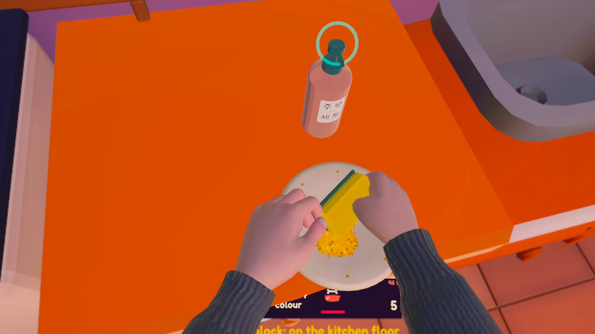 **Two-hand dishwashing** — hold the plate, scrub with the soapy sponge | 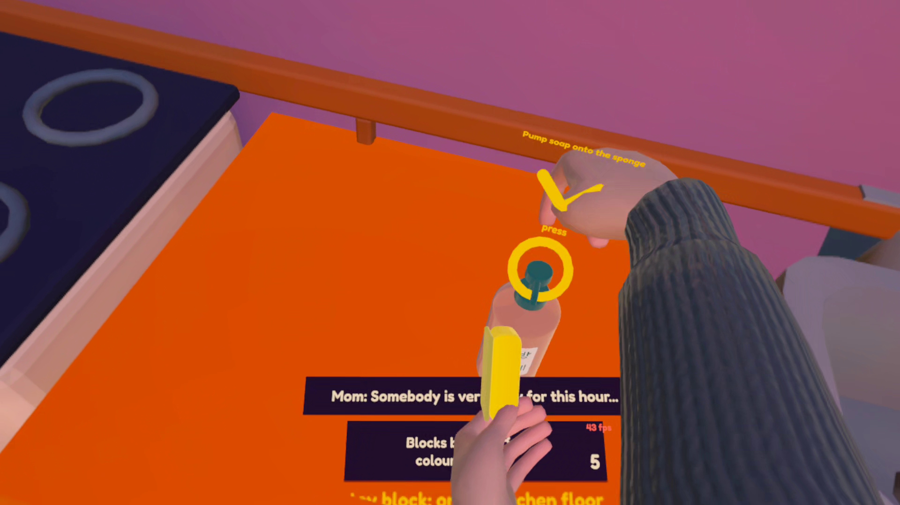 **Soap pump** — the ghost hand shows where to press |
| 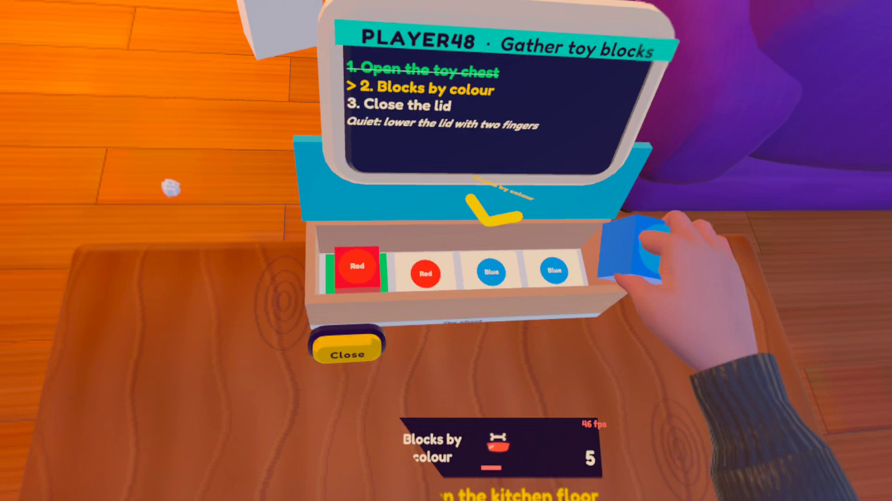 **Toy chest** — press it open, sort blocks by colour | 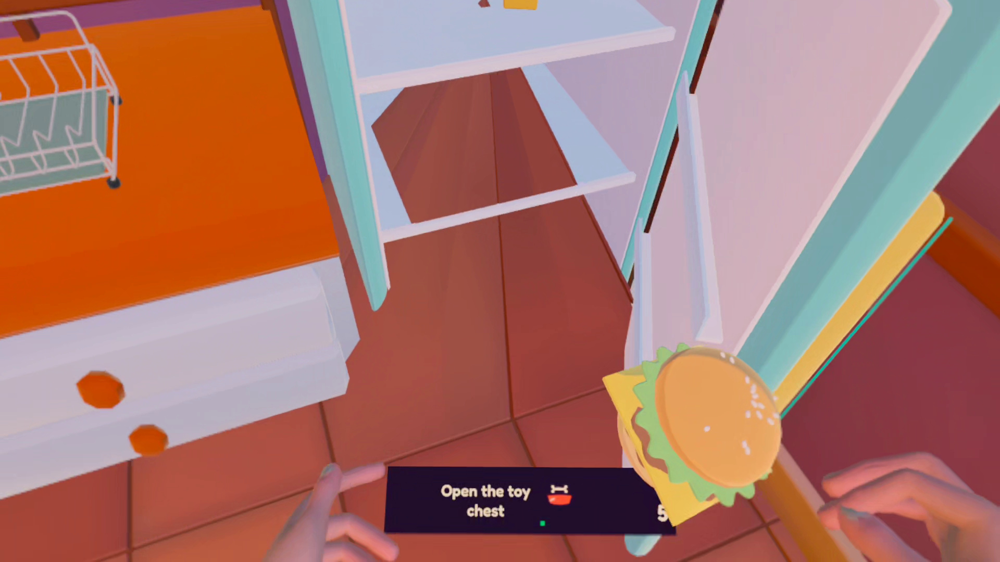 **Fridge** — open by the handle, groceries on the shelves |
| 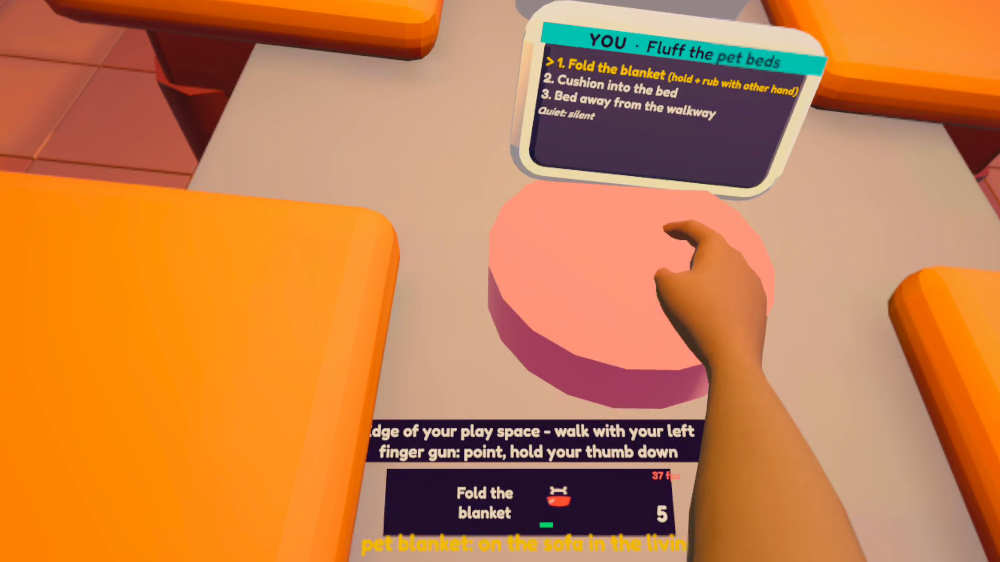 **Fold the blanket** — hold with one hand, rub with the other | 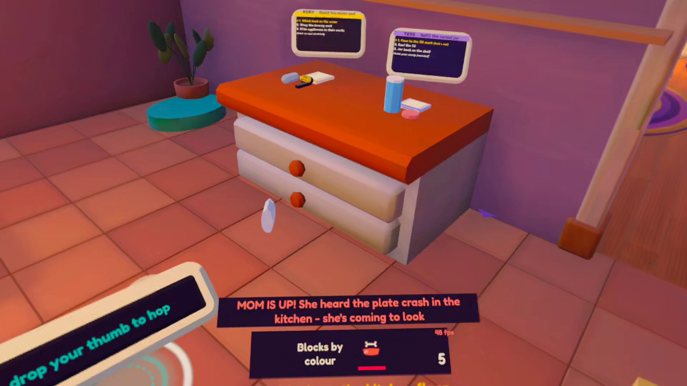 **Plate crash** — and Mom heard it |
| 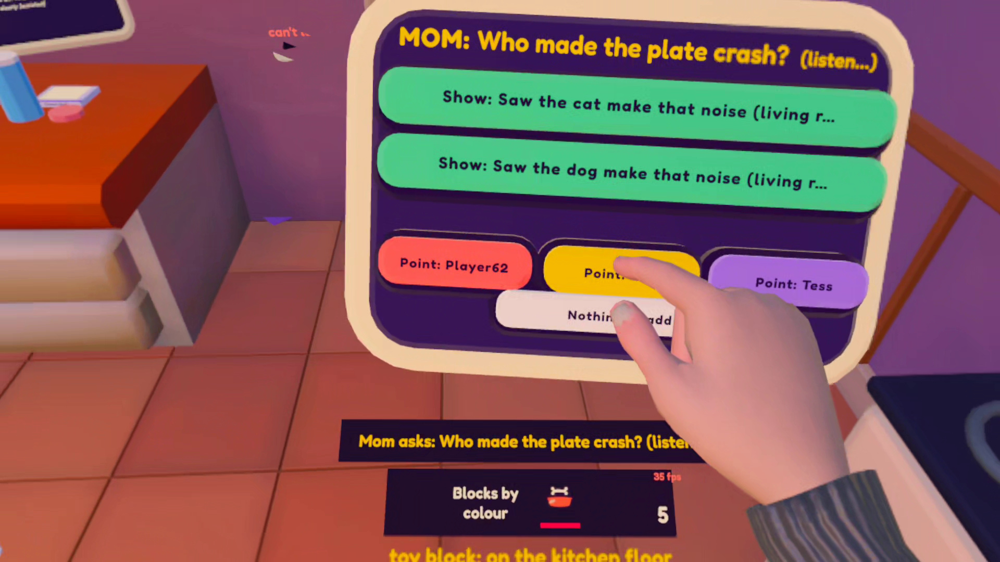 **Mom's interrogation** — point at a sibling, a friend, or the pets | 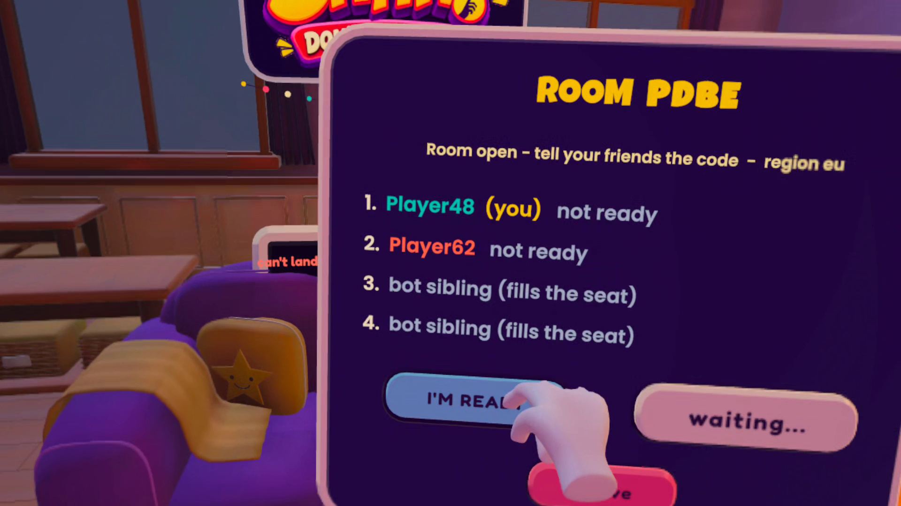 **Online room** — two players ready, bots fill the seats |
| 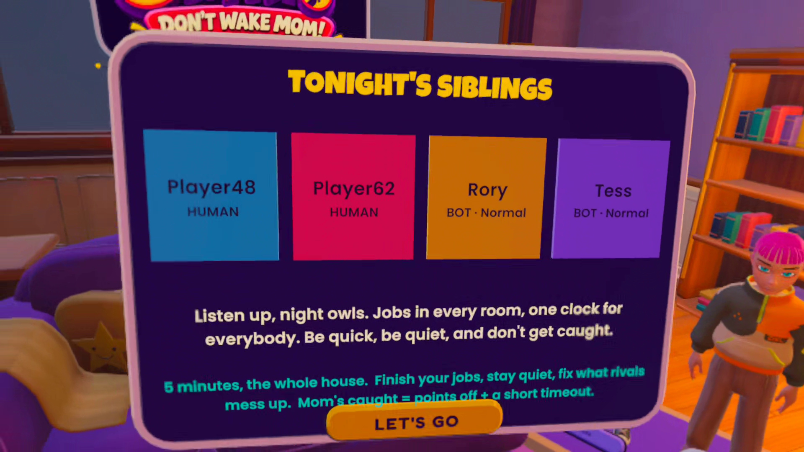 **Tonight's siblings** — humans + bots | 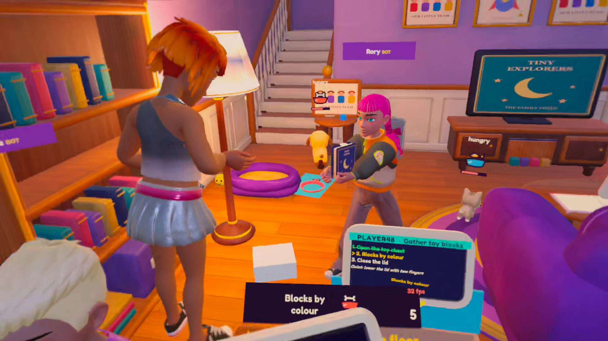 **The house** — bot siblings racing you to every job |
| 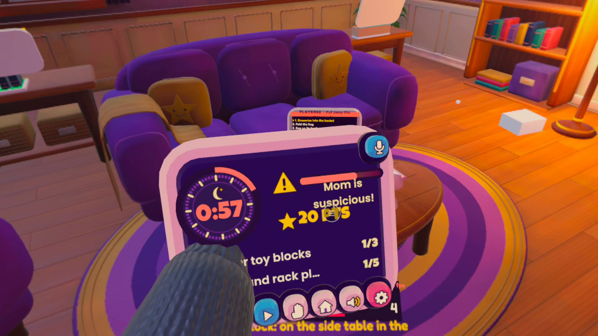 **Wrist watch** — clock, points, Mom's sleep meter | 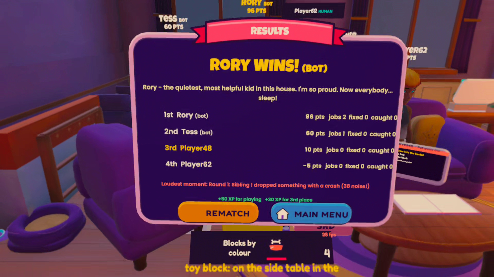 **Results** — the most helpful kid wins |
| 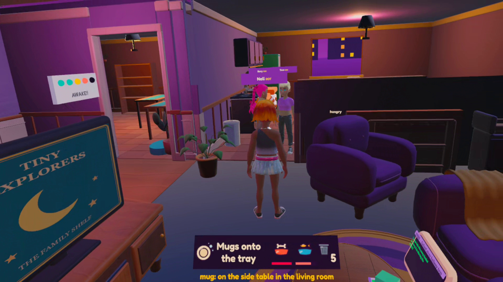 **The house at night** | 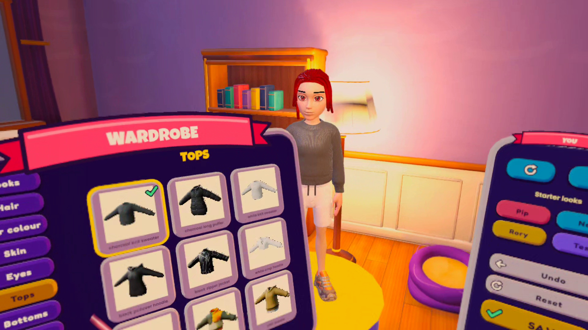 **Wardrobe** — Genies avatar customization |

## ✨ Features

Shown working in the Quest recordings (the videos above):

- **Real hand tracking, no controllers** — grab, pinch, poke, press, two-handed holding and rubbing.
- **Physical chores, not grab-and-place**: two-hand plate scrubbing with a finite-soap pump and stain removal, a hinged fridge opened by its
  handle, a toy chest with a press-to-open drawer and colour slots, a bin with a liftable lid, blanket folding (hold + rub), towel folding,
  slipper pairing, coasters & mugs, pet bowls, a washing machine.
- **73 job recipes** across the house (stable IDs, e.g. `KT01` plates, `KT17` fridge, `LD04/LD05` washer), each with steps validated by
  physical predicates (contact, slot occupancy, hinge angle, volume) — never "touched = done".
- **Noise → Mom**: every impact makes noise (red noise rings), filling Mom's sleep meter; she stirs, warns, wakes, investigates.
- **Mom's interrogation**: a playable board after each wake-up and at the final inspection — point at a sibling, show evidence
  ("saw the cat make that noise", "saw Nell mess with your job"), or stay quiet; "not enough proof" gives everyone a warning.
- **Sabotage & repair**: mess with a rival's job (their card flags *"Someone messed with this!"*), fix what rivals mess up, report what you saw.
- **Bots** (Rookie / Normal / Clever) that use the same validators as humans; **pets** (dog & cat) that cause noise on their own.
- **Online multiplayer** (Photon Fusion): private rooms with a code, 2–4 humans, empty seats filled by bot siblings — a two-human online
  match is in the demo video.
- **Genies Avatar SDK** wardrobe and avatars; starter looks for the four siblings (Pip, Nell, Rory, Tess).
- **Finger-gun locomotion**: aim with a finger gun, drop the thumb to hop; hand-walk; snap turn; seated / standing.
- **Wrist watch & house map**: clock, points, jobs, Mom's state, rooms with jobs and alerts.
- **Interaction hints**: highlight near the hand, next-step arrow, ghost hand after hesitating.
- **Comedy audio**: Mom voice lines, giggling siblings, cartoon stingers; music by Kevin MacLeod (CC BY 4.0).

## 🎮 How to play

1. **Pick a mode** — *Solo* (you vs 3 bot siblings), *Friends* (create / join a private room), *Practice*, *Wardrobe*.
2. **Solo setup** — choose **5 or 10 minutes** ("How long until Mom's alarm?") and bot skill (Rookie / Normal / Clever).
3. **Do your jobs** — your task strip and job cards tell you the steps; everything is done with your hands.
4. **Stay quiet** — lower things gently, close lids with two fingers, keep the pets fed.
5. **Move** — walk in your play space, or make a **finger gun** with your left hand, point, and **drop your thumb to hop**.
6. **When Mom asks** — answer on her board: point, show evidence, or say nothing.
7. **When the clock hits 0:00** — Mom inspects; most points wins (ties: more jobs → less noise → first job done).

## 🧰 Tech stack

| | |
|---|---|
| Engine | **Unity 6000.0.62f1**, Universal Render Pipeline 17 |
| XR | OpenXR 1.16.1, **Meta XR Core SDK 201** (hand tracking) |
| Target | **Meta Quest 2 / Pro / 3 / 3S** (Android, IL2CPP, minSdk 32, targetSdk 34) |
| Networking | **Photon Fusion** (shared authority, one writer per object, compact replicated state) |
| Avatars | **Genies Avatar SDK** (wardrobe, persistence, in-game full-body avatars) |
| Rules engine | `SHHH.Core` — engine-free C# (no `UnityEngine` references), shared by the game and a .NET test runner |
| Tooling | Editor automation bridge (file-based job inbox), Blender 5 Python asset scripts, FFmpeg, Remotion 4 (videos), Krita + Inkscape (thumbnail) |

## 🏗 Architecture

```
UnityProject/Assets/SHHH/
  Scripts/Core/        SHHH.Core - authoritative rules: round, roster, recipes (73), noise & Mom state machine,
                       evidence ledger, scoring, bots' decision rules. Pure C#, unit-tested outside Unity.
  Scripts/Game/        Unity layer
    XR/                hands, grab/pinch/poke, finger-gun hop, head-in-wall fade, interaction hints, perf monitor
    World/             the connected house, mechanisms (hinges, sliders, knobs, buttons, screw caps, washer, vessels, soft cloth),
                       recipe runtime + visuals, pets, clutter placement
    Agents/            Mom (voice director, investigation), bot siblings, pets
    UI/                diegetic boards: menus, wardrobe, wrist watch, house map, interrogation, results
    Audio/             AudioBank: music rotation, voice budget, ducking, impact aggregation
    QA/                RecipeDiagnostic - PlayMode labs run by simulated hands (screenshots per action)
  Networking/          Photon Fusion integration (rooms, region, version check, replicated recipe state)
  Genies/              Genies SDK integration
  Editor/              build pipeline (ShhhBuild), automation bridge commands, scene builder, asset pipeline
  Scenes/              Boot, Startup, FrontEnd, LivingRoom, Kitchen, Laundry, Practice
  Resources/Audio/     SFX, Mom VO bank, music
Core/SHHH.Core.Tests   .NET console test runner compiling the SAME Core files (rules tests + 200 simulated matches)
```

Design rules the code follows (see [`Docs/SHHH_PHYSICS_CONTRACT.md`](Docs/SHHH_PHYSICS_CONTRACT.md) and [`Docs/SHHH_OWNER_REQUIREMENTS.md`](Docs/SHHH_OWNER_REQUIREMENTS.md)):
a step only advances when an authoritative **physical predicate** holds; VFX/SFX react to validated events and are never the truth;
bots feed the same validators as humans; one network writer per object.

## 📁 Repository layout

| Path | What's inside |
|---|---|
| `UnityProject/Assets/SHHH/` | all game code, scenes, our original art, fonts, audio |
| `UnityProject/ProjectSettings/`, `Packages/manifest.json` | Unity project settings and package list |
| `Core/` | the engine-free rules test runner |
| `Docs/` | design locks, production directives, physics contract, QA findings per Quest build, asset licences, build guide |
| `DesignSources/` | UI/brand SVGs, Krita sources, design overrides |
| `Tools/` | automation (`job.sh`, `cycle.sh`, `core_tests.sh`), Blender asset scripts, audio/VO generators, `sign_for_store.sh` |
| `Builds/Quest2_3_3S/BUILDS.csv` | every APK built: version, code, signing, size, sha256 |
| `Remotion/` | Remotion 4 project: the trailer, walkthrough cards and competition demo compositions |
| `VideoProduction/` | the complete video production: footage audit, shot databases, scripts, music licences, edit timelines, QA, gallery, thumbnail |

## 🔨 Building the game

1. **Unity 6000.0.62f1** with Android Build Support (OpenJDK, SDK/NDK).
2. Clone, then **re-import the third-party packages that are not in this repo** (licence reasons — see below): Photon Fusion (+ your own
   Photon App IDs in `PhotonAppSettings`), Genies Avatar SDK (+ your Genies auth settings), Meta XR Core SDK (via Package Manager from
   `manifest.json`), and the art/VFX packs listed in [`Docs/SHHH_ASSET_LICENSES.md`](Docs/SHHH_ASSET_LICENSES.md).
3. Open `UnityProject/`, let it import, open `Assets/SHHH/Scenes/Boot.unity`.
4. Build: *SHHH → Build* menu, or the automation bridge `bash Tools/job.sh build_apk_release` (the Editor must be open; jobs are dropped into
   `Automation/inbox`). Development builds: `build_apk_dev`.
5. **Signing**: release builds read `Secrets/signing.json` (not in the repo). The Meta store app was first uploaded with a development
   build, so store uploads must be re-signed with that key: `bash Tools/sign_for_store.sh <apk>`.

## 🧪 Testing & QA

- **Rules tests** (no Unity needed): `bash Tools/core_tests.sh` → 166/166 passing, including 200 simulated matches.
- **PlayMode labs** with simulated hands: `bash Tools/job.sh recipe_diag "KT01!"` (one recipe end-to-end with a screenshot per action).
- **Quest playtests**: every headset session is analysed from its recording — findings and fixes per build in [`Docs/QA/`](Docs/QA/).
- Status words are kept distinct: *implemented in source · rules test passed · Unity PlayMode verified · two-client verified · APK built ·
  real Quest verified*.

## 🎞 Video production pipeline

Everything that made the three videos is in [`VideoProduction/`](VideoProduction/):

- **Footage audit** — every Quest recording probed (FFprobe), contact sheets, scene detection, duplicates flagged
  ([`00_ProductionAudit`](VideoProduction/00_ProductionAudit/), [`MetaVRStart2026Demo/Analysis`](VideoProduction/MetaVRStart2026Demo/Analysis/)).
- **Frame-by-frame interaction analysis** — 1–4 fps strips of every chore, a 51-moment evidence database and a ranked best-40 list
  ([`COMPLETE_FOOTAGE_ANALYSIS.csv`](VideoProduction/MetaVRStart2026Demo/Analysis/COMPLETE_FOOTAGE_ANALYSIS.csv),
  [`BEST_40_GAMEPLAY_MOMENTS.md`](VideoProduction/MetaVRStart2026Demo/Analysis/BEST_40_GAMEPLAY_MOMENTS.md)).
- **Edits as code** — Python timeline builders → JSON → Remotion compositions (`ShhhTrailer`, `WalkthroughCard`,
  `SHHH-MetaVRStart2026Demo`) with original SHHH! motion graphics (moon wipes, candy swooshes, star pops, impact accents, logo finale).
- **Narration** — Kokoro-82M TTS (offline, Apache-2.0), every line verified by speech recognition (faster-whisper) in the final mix.
- **Mix** — music ducked under voice, game SFX synced to on-screen events, two-pass loudness to −14 LUFS / ≤ −1 dBTP.
- **QA** — duration, codec, colour range, loudness, black/freeze/flash detection, final contact sheets.
- **Thumbnail** — frame graded in **Krita** (layered `.kra`), composed in **Inkscape** (SVG, brand fonts as outlines).

## 🚫 What is NOT in this repository

| Not included | Why |
|---|---|
| `Secrets/` (keystores, signing passwords, Photon/Genies credentials), `PhotonAppSettings.asset`, `GeniesAuthSettings.bytes` | private credentials |
| Photon Fusion / Voice SDK, Genies SDK, Meta/Oculus SDK folders, Asset Store VFX & model packs, third-party model packs in `Art/ThirdParty/` | third-party licences do not allow redistributing them in a public repo — re-import them (list in `Docs/SHHH_ASSET_LICENSES.md`) |
| APKs, raw Quest recordings, rendered videos, Unity `Library/` | size — the videos are on YouTube, the builds on the Meta store |
| Reference trailers of other games | used only to study pacing; never in our videos |

## 🙏 Credits & licences

- **Game, code, original art & design** — Souhil SID / Ringooo Studios.
- **Music** — Kevin MacLeod (incompetech.com), licensed under Creative Commons: By Attribution 4.0 — https://creativecommons.org/licenses/by/4.0/ —
  "Fluffing a Duck", "Marty Gots a Plan", "Sneaky Adventure", "Investigations", "Scheming Weasel (faster version)".
- **Fonts** — Fredoka, Luckiest Guy, Poppins, Quicksand (SIL Open Font License).
- **Voices** — Mom's in-game lines: Piper TTS; video narration: Kokoro-82M (Apache-2.0). All synthetic, made for this project.
- **3D models** — original SHHH! models (Blender scripts in `Tools/blender`) plus third-party packs credited in
  [`Docs/SHHH_ASSET_LICENSES.md`](Docs/SHHH_ASSET_LICENSES.md).
- **Built with** Unity, Meta XR SDK, Photon Fusion, Genies Avatar SDK, Remotion, FFmpeg, Blender, Krita, Inkscape.

<p align="center"><i>Shhh… don't wake Mom.</i></p>
